# Manuel d'utilisation · EnMKit

**Application mobile des propriétaires de logements équipés d'un kit EnMKit**

Éditeur : 2ME Technologies SARL · contact@2metechsarl.org · https://www.2metechsarl.org  
Application : EnMKit (Android), version 1.0.1  
Public : propriétaires et gestionnaires de logements. Aucune connaissance technique n'est nécessaire.

---

## Sommaire

1. Présentation et installation
2. Premier lancement
3. Ajouter un kit
4. Configurer le kit
5. Piloter les lignes
6. Suivre la consommation
7. Partager un kit par QR Code
8. Aide et support
9. Réglages
10. Questions fréquentes et dépannage

---

## 1. Présentation et installation

### 1.1 À quoi sert l'application

Chaque logement est équipé d'un **kit** EnMKit : un boîtier relié au tableau électrique, avec sa propre carte SIM. L'application EnMKit pilote ce kit **par SMS**. Aucune connexion Internet n'est nécessaire.

Avec l'application, vous pouvez :

- allumer et éteindre les **lignes** (circuits électriques) d'un logement (ON / OFF) ;
- voir les **confirmations** envoyées par le kit après chaque commande ;
- demander la **consommation** relevée par le compteur, et garder un historique ;
- **configurer** le kit (compteur et numéros autorisés) ;
- gérer **plusieurs logements** depuis un seul téléphone ;
- **partager** un kit avec un autre téléphone grâce à un QR Code ;
- contacter le **support** EnMKit par SMS ou WhatsApp.

### 1.2 Installer l'APK

L'application est distribuée sous forme de fichier APK (Android uniquement).

1. Sur le téléphone, ouvrez https://www.2metechsarl.org, page **Application mobile**.
2. Téléchargez l'APK **EnMKit**.
3. Ouvrez le fichier téléchargé.
4. Si Android le demande, autorisez l'installation depuis cette source (navigateur ou gestionnaire de fichiers).
5. Appuyez sur **Installer**, puis **Ouvrir**.

> Mise à jour : installez simplement le nouvel APK par-dessus l'ancien. Vos kits et vos réglages sont conservés. En revanche, le **code d'accès est effacé à chaque mise à jour** : l'application propose à nouveau d'en créer un (section 2.2), et vous pouvez toujours **Passer pour l'instant**.

### 1.3 Permissions demandées

L'application demande les autorisations suivantes. Acceptez-les : sans elles, le pilotage ne fonctionne pas.

| Permission | Pourquoi |
|---|---|
| SMS (envoi, réception, lecture) | Envoyer les commandes au kit et lire ses réponses, même application fermée. Demandée au démarrage. |
| Notifications | Vous prévenir à l'arrivée d'une réponse (Android 13 et plus). Demandée au démarrage. |
| Appareil photo | Scanner le QR Code d'un kit. Demandée à la première utilisation du scanner. |
| Empreinte digitale | Déverrouillage par empreinte (facultatif). |

Le téléphone doit avoir une **carte SIM active avec du crédit SMS**. Le kit doit lui aussi avoir une SIM avec du réseau et du crédit SMS.

---

## 2. Premier lancement

### 2.1 Présentation

Trois écrans présentent l'application :

1. **Pilotez vos kits à distance**
2. **Suivez votre consommation**
3. **Sécurisé et multi-kits**

Appuyez sur **Suivant** pour avancer, puis **Commencer** sur le dernier écran. **Passer** (en haut à droite) saute la présentation. Elle n'apparaît qu'une fois.

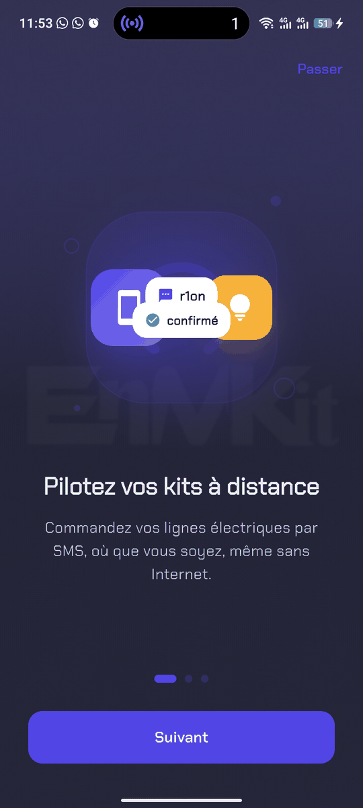 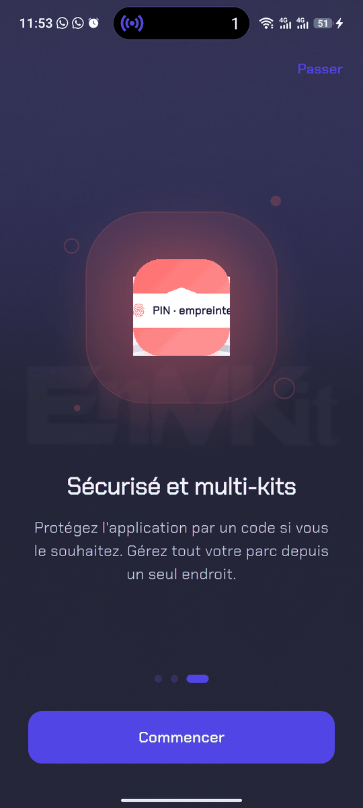

<em>Écrans de présentation au premier lancement</em>

### 2.2 Code d'accès (facultatif)

Juste après la présentation, l'application propose de créer un code d'accès. Ce code est **facultatif**.

- Pour ne pas en créer : appuyez sur **Passer pour l'instant**. Vous arrivez directement sur l'accueil.
- Pour en créer un :
  1. Tapez un code de **4 chiffres** sur le clavier (**Créez votre code**).
  2. Tapez-le une seconde fois (**Confirmez le code**).
  3. Choisissez deux **Questions de récupération** différentes et répondez-y. Elles servent si vous oubliez le code. Les majuscules et les espaces ne comptent pas.
  4. Si le téléphone a une empreinte enregistrée, l'application propose **Activer l'empreinte** ou **Plus tard**.

Cette proposition n'apparaît qu'une seule fois. Vous pourrez activer ou désactiver le code plus tard dans **Réglages > Sécurité** (section 9).

Quand le code est activé, il est demandé à l'ouverture de l'application et **à chaque retour dans l'application** (après être passé sur une autre application, par exemple).

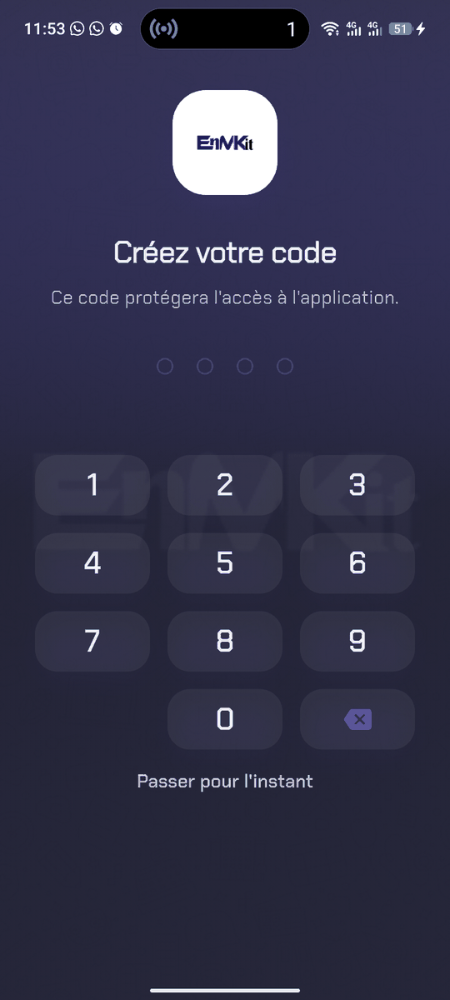

<em>Création du code, avec « Passer pour l'instant »</em>

### 2.3 Se déplacer dans l'application

La barre de navigation du bas est **flottante** et n'affiche que des **icônes**. Une bulle colorée glisse sous l'onglet ouvert. Elle compte **3 onglets** :

| Position | Onglet | Contenu |
|---|---|---|
| 1 | **Accueil** (maison) | Vos kits (« Mes kits »). |
| 2 | **Aide** (bulles de discussion) | Demande d'assistance et conversation avec le support. |
| 3 | **Réglages** (curseurs) | Apparence, langue, sécurité, FAQ, version. |

- **Appui long** sur une icône : affiche le nom de l'onglet.
- **Point rouge sur l'icône Aide** : le support vous a répondu et vous n'avez pas encore lu la réponse. Il disparaît dès que vous ouvrez l'onglet Aide.

---

## 3. Ajouter un kit

### 3.1 L'accueil « Mes kits »

L'accueil affiche la carte **Mon parc** : le nombre de kits, le nombre de kits configurés (cadenas) et, s'il y en a, les kits **à valider** ou **en attente** de réponse.

Chaque kit apparaît sur une carte avec son nom et son numéro. À droite de la carte :

- un **cadenas** : le kit est configuré et verrouillé ;
- une puce **À valider** : il ne reste que la validation finale de la configuration (section 4.3) ;
- un **point orange** : la configuration n'a pas encore été reçue par le kit.

Touchez une carte pour ouvrir le kit.

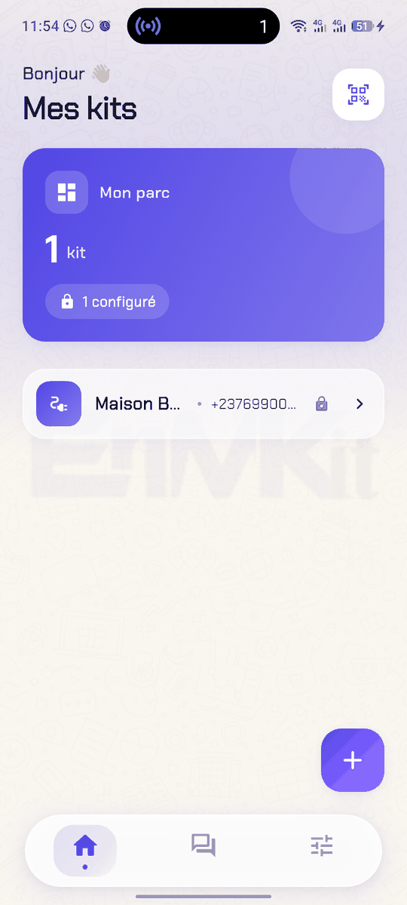

<em>Accueil : le parc de kits et la barre de navigation en icônes</em>

### 3.2 Ajouter un kit à la main

1. Dans l'onglet **Accueil**, appuyez sur le bouton **+** (en bas à droite).
2. Dans la fenêtre **Nouveau kit**, renseignez :
   - **Nom du kit** : par exemple « Appartement A » ou « Boutique » ;
   - **Numéro du kit** : le numéro de la carte SIM du kit (obligatoire) ;
   - **Nombre de lignes** : **4**, **7** ou **Personnalisé** (de 1 à 7, avec les boutons moins et plus).
3. Appuyez sur **Ajouter le kit**.

Les lignes sont créées automatiquement (« Ligne 1 », « Ligne 2 », etc.). Vous pourrez les renommer ensuite (section 5.4).

> Conseil : donnez à chaque kit le nom du logement. Vous vous y retrouverez plus facilement quand le parc grandit.

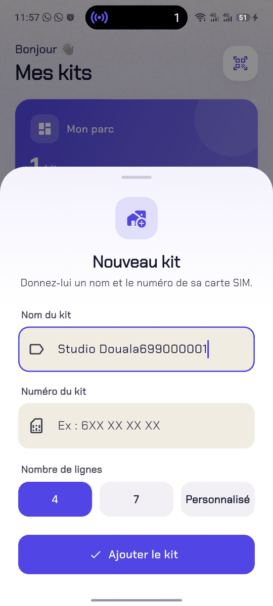

<em>Fenêtre « Nouveau kit » avec le choix du nombre de lignes</em>

### 3.3 Importer un kit par QR Code

Si le kit est déjà enregistré sur un autre téléphone, vous pouvez le récupérer sans rien ressaisir.

1. Sur l'autre téléphone, affichez le QR Code du kit (section 7).
2. Sur votre téléphone, dans l'en-tête de l'**Accueil**, appuyez sur l'icône de **scanner** (en haut à droite).
3. Autorisez l'appareil photo si Android le demande.
4. Placez le QR Code dans le cadre (**Scanner un kit**).
5. Le message **Kit « … » importé** confirme l'import.

Le kit arrive avec son nom, ses lignes, ses numéros autorisés et l'état de sa configuration. Si le kit existait déjà sur votre téléphone, il est mis à jour.

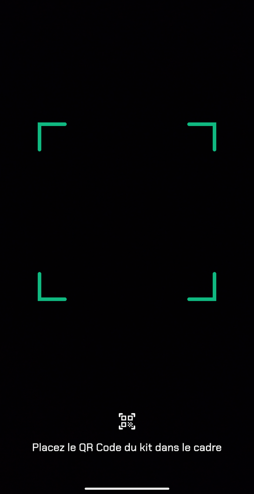

<em>Écran « Scanner un kit »</em>

### 3.4 Supprimer un kit

Faites glisser la carte du kit vers la gauche ou la droite, puis confirmez (**Supprimer ce kit ?**). Toutes ses données (lignes, confirmations, consommation) sont supprimées. Cette action est irréversible.

### 3.5 L'écran d'un kit

Touchez la carte d'un kit pour l'ouvrir. L'écran comporte 3 onglets :

| Onglet | Rôle |
|---|---|
| **Lignes** | Allumer et éteindre chaque ligne. |
| **Conso** | Demander et consulter la consommation. |
| **Config** | Paramètres du kit, numéros autorisés, envoi de la configuration, QR Code. |

---

## 4. Configurer le kit

À faire **une seule fois**, avant de piloter le kit.

### 4.1 Renseigner les paramètres

1. Ouvrez l'onglet **Config**.
2. **Informations du kit** : vérifiez le **Nom** et le **Numéro du kit**. Pour les corriger, appuyez sur le **crayon** de la carte, modifiez, puis **Enregistrer**.
3. **Compteur** : appuyez sur le **crayon**, puis renseignez :
   - **Impulsion par kWh** : la constante du compteur (nombre entier supérieur à 0, par exemple 1000). Elle figure sur le compteur ou sur la fiche remise par l'installateur ;
   - **Consommation initiale (kWh)** : l'index de départ du compteur.
4. **Numéros autorisés** (**Numéro 1** et **Numéro 2**) : ce sont les téléphones qui pourront commander le kit. Mettez au moins le vôtre.
   - Un numéro vide s'ouvre directement en saisie.
   - Pour modifier un numéro déjà enregistré, **appuyez deux fois** dessus.
   - Validez avec le bouton **vert**, ou annulez avec le bouton **rouge**.

> Le kit n'accepte que **deux** numéros autorisés. Il n'obéit qu'à ces numéros.

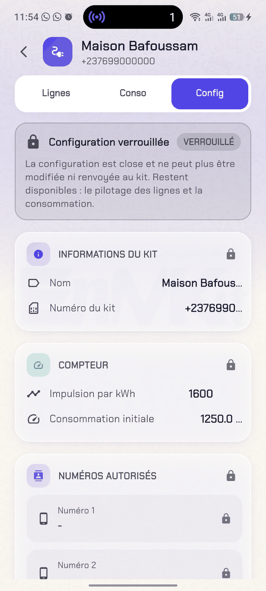

<em>Onglet Config d'un kit dont la configuration est validée : elle est verrouillée</em>

### 4.2 Envoyer la configuration

1. Appuyez sur **Envoyer la configuration au kit**.
2. La fenêtre **Vérifier la configuration** montre ce qui partira par SMS : Numéro 1, Numéro 2, Conso initiale, Impulsion par kWh.
3. Relisez, puis appuyez sur **Envoyer au kit** (ou **Annuler** pour corriger).

Si l'**Impulsion par kWh** vaut 0 ou n'est pas renseignée, l'envoi est refusé : corrigez la carte **Compteur** d'abord.

### 4.3 Suivre et valider la configuration

En haut de l'onglet **Config**, un volet d'état suit la configuration :

| État affiché | Signification | Action |
|---|---|---|
| **Configuration envoyée** (EN COURS) | Le kit n'a pas encore répondu. La réponse peut prendre plusieurs minutes. Elle sera reconnue même si vous quittez l'application. | Patienter. |
| **Le retour du kit correspond** (OK) | Le kit a renvoyé exactement ce qui lui a été envoyé. | Appuyer sur **Valider et verrouiller**. |
| **Configuration verrouillée** (VERROUILLÉ) | La configuration est close. | Plus de modification possible. |

Quand la réponse du kit arrive, une fenêtre **Le kit a bien reçu la configuration** peut aussi s'ouvrir d'elle-même. Elle liste les valeurs confirmées. Relisez-les, puis appuyez sur **OK** pour valider, ou **Annuler** pour corriger d'abord.

> Attention : la validation est **définitive**. Toute modification ultérieure devra passer par les administrateurs. Relisez bien les numéros et les paramètres du compteur avant de valider.

Sur l'accueil, la puce **À valider** sur la carte d'un kit indique qu'il ne reste que cette validation. Touchez-la pour l'effectuer.

Une fois verrouillée, la configuration affiche des cadenas et le bouton d'envoi disparaît. Le pilotage des lignes et la consommation restent disponibles.

> Les commandes de l'onglet **Lignes** ne s'activent qu'une fois la configuration reçue par le kit (section 5.1).

---

## 5. Piloter les lignes

### 5.1 Allumer et éteindre

Ouvrez l'onglet **Lignes**. La rubrique **Commande des lignes** liste les lignes du kit. Chaque ligne a deux boutons : **ON** et **OFF**.

Tant que la configuration n'a pas été reçue par le kit (section 4), un bandeau **Kit non configuré** s'affiche en haut de l'onglet et les boutons ON / OFF sont désactivés : le kit ne connaît pas encore les numéros autorisés à le commander. Sur l'accueil, le kit garde alors son point orange.

1. Appuyez sur **ON** pour allumer, ou **OFF** pour éteindre.
2. Le téléphone envoie un SMS au kit. Un petit cercle tourne sur le bouton appuyé.
3. Pendant l'attente, les deux boutons de la ligne sont bloqués : impossible d'envoyer deux fois la même commande par erreur.
4. Quand le kit confirme, la fenêtre **Confirmation de la commande** s'ouvre et affiche la confirmation.

Si le kit ne répond pas, les boutons se débloquent seuls après quelques secondes. La commande est bien partie : la confirmation peut encore arriver plus tard.

> Les boutons ON et OFF ne montrent pas l'état de la ligne : ce sont de simples commandes. L'état fiable est celui **confirmé par le kit**, visible dans les confirmations (section 5.3).

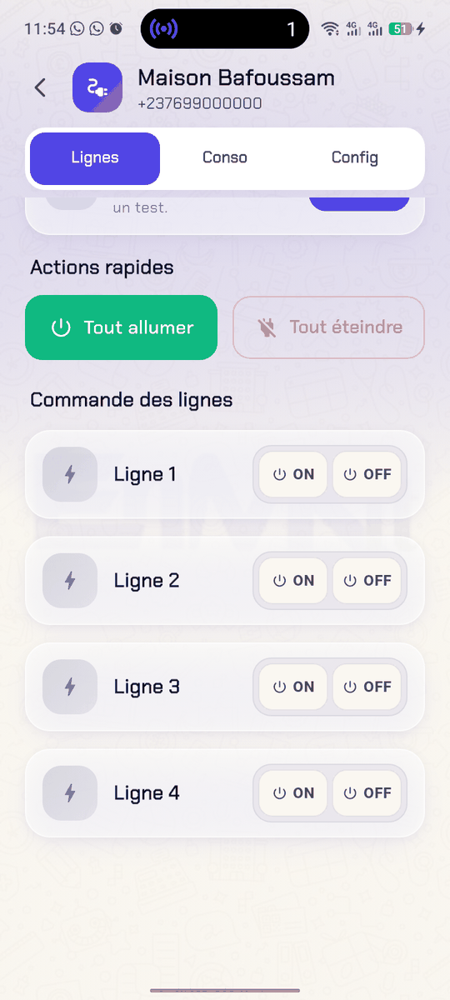

<em>Onglet Lignes : les boutons ON / OFF de chaque ligne</em>

### 5.2 Tester le kit et actions rapides

Une fois le kit configuré, deux cartes apparaissent en haut de l'onglet **Lignes** :

- **Connexion du kit** : appuyez sur **Tester**. Le téléphone envoie une demande de consommation au kit (message **Test envoyé au kit…**). Le statut passe à **Vérification du kit…**, puis à **Kit joignable** si le kit répond dans les 45 secondes, sinon à **Kit injoignable** : vérifiez alors que sa carte SIM a du réseau et du crédit SMS. Avant tout test, le statut indique **Statut inconnu. Lancez un test.**
- **Actions rapides** : **Tout allumer** ou **Tout éteindre**. Seules les lignes qui changent d'état reçoivent une commande, avec un court délai entre chaque SMS. Chaque SMS est payant : évitez d'appuyer plusieurs fois.

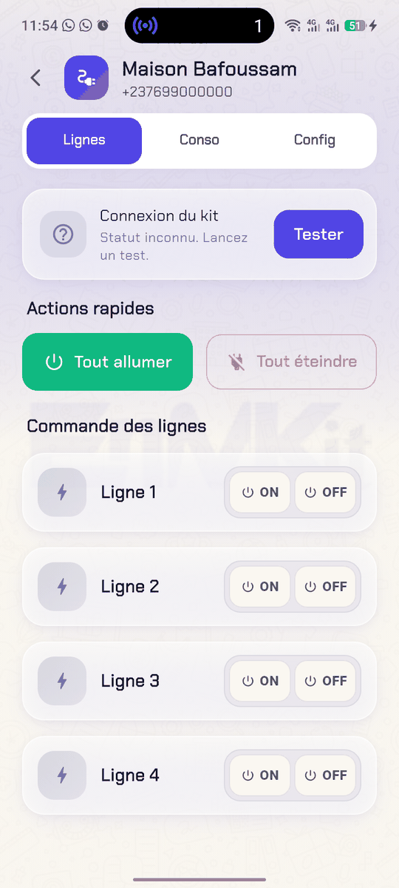

<em>Onglet Lignes : carte « Connexion du kit » et actions rapides</em>

### 5.3 Voir les confirmations du kit

Dès qu'une ligne a reçu au moins une confirmation, une icône **horloge** apparaît à côté de son nom. Touchez-la pour ouvrir **Confirmation de la commande**.

Chaque entrée indique :

- l'état confirmé, par exemple « Salon est alimenté(e) » ou « Salon est désalimenté(e) » ;
- le texte exact du SMS renvoyé par le kit ;
- l'heure : « Aujourd'hui 09:12 », « Hier 20:00 », ou la date pour les plus anciennes.

Les confirmations sont enregistrées **même application fermée**. Si un autre téléphone autorisé commande le kit, ses confirmations apparaissent aussi chez vous.

### 5.4 Renommer ou supprimer une ligne

1. **Appuyez deux fois** sur la carte de la ligne. Le nom devient modifiable.
2. Saisissez le nouveau nom (par exemple « Climatiseur », « Chambre », « Pompe »).
3. Appuyez sur le bouton **vert** pour enregistrer.

Pour supprimer la ligne, appuyez sur le bouton **rouge** en mode modification, puis confirmez (**Supprimer cette ligne ?**).

> Le nombre de lignes se choisit à la création du kit. On ne peut pas en ajouter ensuite.

---

## 6. Suivre la consommation

1. Ouvrez l'onglet **Conso**.
2. Appuyez sur **Vérifier votre consommation électrique**.
3. Le message **Demande envoyée au kit…** s'affiche, puis **En attente de la réponse du kit…**.
4. À réception : **Nouvelle mesure reçue**. La **Dernière mesure** (en kWh) est mise à jour.

Sans réponse au bout d'une minute environ : **Aucune réponse du kit. Vérifiez le réseau/numéro et réessayez.** La réponse reste prise en compte si elle arrive plus tard.

Sous la dernière mesure :

- la courbe **Évolution** (à partir de deux mesures), avec la variation par rapport à la mesure précédente ;
- la liste **Historique** : les 20 dernières mesures, avec la date et l'heure.

Tirez l'écran vers le bas pour actualiser l'affichage.

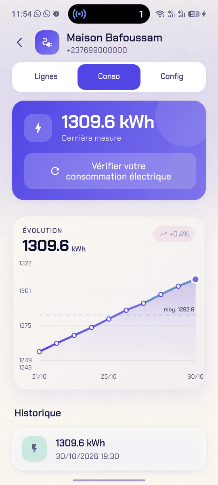

<em>Onglet Conso : dernière mesure, évolution et historique</em>

---

## 7. Partager un kit par QR Code

Le QR Code contient la configuration du kit : nom, numéro, lignes et numéros autorisés. Il sert à :

- donner l'accès à un logement à un gardien ou à un proche (sans lui donner le reste de votre parc) ;
- retrouver un kit après un changement de téléphone.

1. Ouvrez le kit, onglet **Config**.
2. Appuyez sur **Générer le QR Code**. L'écran **QR Code du kit** s'affiche (**Scannez pour importer ce kit**).
3. Faites-le scanner par l'autre téléphone (section 3.3), ou appuyez sur **Partager le QR Code** pour l'envoyer en image.

> Pour que l'autre téléphone puisse commander le kit, son numéro doit faire partie des **Numéros autorisés**.

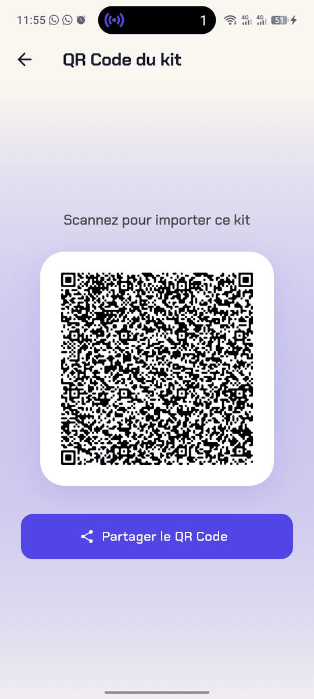

<em>Écran « QR Code du kit »</em>

---

## 8. Aide et support

L'onglet **Aide** (titre **Aide & assistance**) permet d'écrire au support EnMKit. La demande part **par SMS**, et la réponse s'affiche dans la conversation.

1. **Votre besoin** : choisissez l'objet :
   - Configuration d'un numéro (puis **Quelle action ?** : Ajouter, Modifier ou Supprimer un numéro, et **Numéro concerné**) ;
   - Problème de réception de la consommation ;
   - Problème de commande d'une ligne ;
   - Kit injoignable ;
   - Autre demande.
2. **Kit concerné** : sélectionnez le kit (si vous en avez plusieurs).
3. **Précisions** : décrivez brièvement (facultatif).
4. Relisez l'aperçu du message, puis appuyez sur **Envoyer au support**. Confirmation : **Demande envoyée au support**.
5. Les échanges apparaissent dans **Conversation**. Répondez dans **Votre réponse**.

Autre possibilité : **Continuer sur WhatsApp** ouvre WhatsApp avec le message préparé (Internet nécessaire).

Quand le support répond, un **point rouge** apparaît sur l'icône Aide de la barre du bas.

Contact écrit : contact@2metechsarl.org.

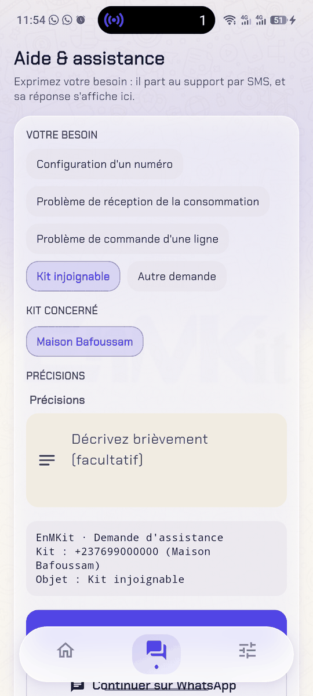

<em>Aide et assistance : demande au support</em>

---

## 9. Réglages

| Section | Réglage | Détail |
|---|---|---|
| **Apparence** | Clair, Sombre, Auto | Auto suit le thème du téléphone. |
| **Couleur d'accent** | Palette de couleurs | Change la couleur principale de l'interface. |
| **Langue** | Français, English | Change la langue de l'interface. |
| **Sécurité** | **Code de sécurité** | Interrupteur. L'activer crée un code et vous fait choisir les questions de récupération. Le désactiver demande le code actuel. |
| | **Déverrouillage par empreinte** | Visible si le code est activé. Le code reste le secours. |
| | **Questions de récupération** | Définir ou modifier les deux questions. |
| | **Modifier le code d'accès** | **Code actuel**, **Nouveau code**, **Confirmer le code**. |
| **Aide** | **Questions fréquentes (FAQ)** | Rubriques Accès et sécurité, Kit et lignes, QR Code et partage, Dépannage. En français ou en anglais selon la langue choisie. |
| **À propos** | Application, Version | Informations sur l'application. La version affichée est celle installée sur le téléphone. |

> Le code d'accès compte toujours **exactement 4 chiffres**, à la création comme au changement ou après un code oublié. Un code plus court ou plus long est refusé.

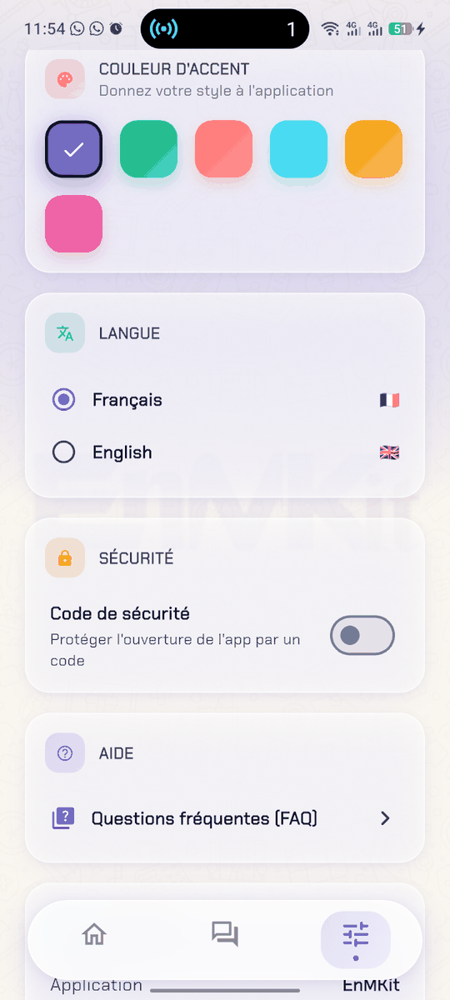

<em>Réglages : apparence, langue et sécurité</em>

---

## 10. Questions fréquentes et dépannage

### Le kit ne répond pas (SMS non reçus)

1. Vérifiez que l'application a l'autorisation **SMS** (Paramètres Android > Applications > EnMKit > Autorisations).
2. Vérifiez le crédit SMS et le réseau **du téléphone** et **du kit**.
3. Vérifiez le **Numéro du kit** dans l'onglet **Config** (bon numéro, sans faute de frappe).
4. Vérifiez que votre téléphone fait partie des **Numéros autorisés** du kit : le kit n'obéit qu'à ces numéros.
5. Vérifiez que la configuration a bien été envoyée et validée (section 4).
6. Patientez : une réponse peut prendre plusieurs minutes. Elle sera reconnue même si l'application est fermée.
7. Faites un essai simple : onglet **Lignes**, carte **Connexion du kit**, appuyez sur **Tester** (section 5.2). **Kit joignable** confirme que le kit répond.
8. Si le problème persiste : onglet **Aide**, objet « Kit injoignable ».

### J'ai appuyé sur ON, mais rien ne se passe dans l'application

- Le SMS est parti, mais le kit n'a pas encore confirmé. Les boutons se débloquent seuls après quelques secondes.
- Attendez la confirmation (icône **horloge** de la ligne). Ne renvoyez pas la commande plusieurs fois : chaque appui coûte un SMS.
- Si les boutons ON / OFF restent grisés avec le bandeau **Kit non configuré**, envoyez d'abord la configuration (section 4).

### La configuration reste « EN COURS »

- C'est normal pendant quelques minutes.
- Si rien n'arrive au bout d'un long moment, vérifiez le crédit et le réseau du kit, puis renvoyez la configuration.

### J'ai fermé la fenêtre de validation par erreur

Rien n'est perdu. Ouvrez l'onglet **Config** du kit et appuyez sur **Valider et verrouiller**, ou touchez la puce **À valider** sur l'accueil.

### Je dois changer un numéro autorisé après le verrouillage

La configuration verrouillée ne se modifie plus depuis l'application. Onglet **Aide**, objet « Configuration d'un numéro », choisissez l'action et indiquez le numéro concerné.

### J'ai changé de téléphone

Sur l'ancien téléphone, générez le QR Code de chaque kit (section 7) et scannez-le avec le nouveau. Pensez à conserver une copie des QR Codes.

### Code oublié

1. Sur l'écran de saisie du code, appuyez sur **Code oublié ?**.
2. Répondez à vos deux questions de récupération.
3. Saisissez le nouveau code (4 chiffres) et sa confirmation.
4. Appuyez sur **Réinitialiser le code**.

Si le message **Aucune question de récupération n'est configurée sur cet appareil.** s'affiche, contactez le support (contact@2metechsarl.org).

### L'empreinte ne fonctionne pas

- Message **Aucune empreinte enregistrée sur cet appareil.** : enregistrez d'abord une empreinte dans les réglages Android.
- En cas d'échec, saisissez simplement votre code : il reste toujours le secours.

### L'application me redemande le code tout le temps

C'est voulu : quand le code est activé, il est redemandé à chaque retour dans l'application. Pour éviter cela, activez le **Déverrouillage par empreinte**, ou désactivez le code dans **Réglages > Sécurité**.

---

*2ME Technologies SARL · EnMKit · contact@2metechsarl.org · https://www.2metechsarl.org*
